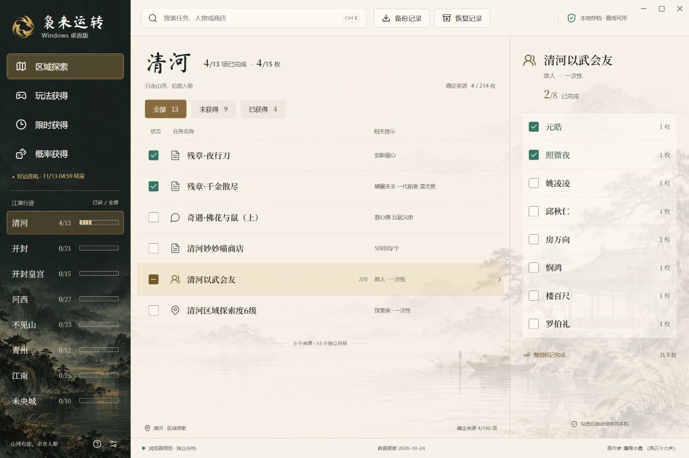

# 袅来运转桌面版

[](https://github.com/MIGO-OvO/niaolaiyunzhuan-desktop/releases/latest)
[](https://github.com/MIGO-OvO/niaolaiyunzhuan-desktop/actions/workflows/ci.yml)
[](https://v2.tauri.app/)
[](https://github.com/MIGO-OvO/niaolaiyunzhuan-desktop/releases/latest)
[](./docs/LICENSING.md)

《燕云十六声》袅袅之音获取记录与查漏工具，使用 Rust、Tauri 2、React 和 TypeScript 开发。
原作者：**薄荷小鹿（燕云十六声）**，数据来自 [niaolaiyunzhuan-web](https://github.com/MiaTheamateur/niaolaiyunzhuan-web)。

**[下载最新安装包](https://github.com/MIGO-OvO/niaolaiyunzhuan-desktop/releases/latest)** ·
[1.5.0 发布说明](./docs/releases/v1.5.0.md) ·
[问题反馈](https://github.com/MIGO-OvO/niaolaiyunzhuan-desktop/issues)



## 功能

- 按区域、玩法、限时和概率来源查找目标；按 **Ctrl K** 搜索任务、人物和商店。
- 三栏查看分类、来源和独立目标，支持单项勾选、整组完成与分组半选。
- 每次勾选自动保存到本机，支持离线记录、周期刷新、活动倒计时和新增提示。
- 导出 PNG 二维码备份，读取网页版 NYNZ1、NYNZ2 备份，预览后合并已有记录。
- 自定义标题栏，支持拖动、双击最大化、最小化、还原和关闭；最小窗口为 1080×700。
- 启动时检查 GitHub Release，在“设置与更新”中下载并安装通过签名校验的新版本。

当前数据为网页版 **v1.5.0 修订 73**：128 条来源、207 个独立目标。
概率来源单独统计，不计入确定来源的袅袅总量。

## 安装和使用

1. 在 [Releases](https://github.com/MIGO-OvO/niaolaiyunzhuan-desktop/releases/latest) 下载
   `niaolaiyunzhuan_1.5.0_x64-setup.exe` 并运行。
2. 从左侧选择分类或区域，点击来源后在右侧勾选已完成的目标。
3. 点击顶部“备份记录”保存 PNG。换电脑或从网页版迁移时，用“恢复记录”读取原图并合并。
4. 左下角齿轮打开“设置与更新”，可检查新版本、查看存档位置及重置进度。

运行环境为 Windows 10/11 x64、Microsoft Edge WebView2。缺少 WebView2 时，安装器会联网安装运行时。
日常记录可离线使用，在线更新需要能够访问 GitHub。

安装包带有 **Tauri 更新签名**。Windows Authenticode 发布者证书尚未配置，因此 Windows 可能显示“未知发布者”。

### 在线更新

程序从公开仓库最新正式 Release 的 `latest.json` 读取版本、安装包地址和签名。
发现新版本后，底部会显示更新入口；点击“下载并安装”后显示下载进度，更新完成后自动启动程序。

Tauri 官方 updater 使用程序内置公钥校验安装包，并校验签名中的版本号与 Release 清单一致。
下载或校验失败会显示错误，允许重新检查和下载。本地进度保存在应用数据目录，安装更新会继续使用原存档。

Release 附件用途：

| 附件 | 用途 |
| --- | --- |
| `*_x64-setup.exe` | Windows 安装包 |
| `*.exe.sig` | 安装包的 Tauri / Minisign 签名 |
| `latest.json` | 程序读取的更新清单 |
| `SHA256SUMS` | 手动校验文件 SHA-256 |

维护者发布步骤、Secrets 配置和密钥备份见 [发布指南](./docs/RELEASING.md)。

## 存档和兼容性

桌面版存档位于 `%APPDATA%\com.niaolaiyunzhuan.desktop`：

- `progress.json`：当前进度。
- `progress.previous.json`：上一份有效存档。

保存使用同目录临时文件原子替换。写入失败时显示错误并保留原进度。
主存档损坏时读取上一份并提示；两份均不可读或存档版本较新时，保留文件并停止写入。
程序只运行一个实例。

PNG 恢复合并已完成项，保留本机已有勾选；周期项目合并到恢复时的当前周期。
周、月边界使用北京时间。定期来源沿用数据的 `refreshCycleId`；`refreshAt` 表示本期截止时间。
活动倒计时结束后保留 24 小时；含 `expiresAt` 的来源到期隐藏，历史记录保留。

导入图片限制为 16 MB、4096×4096 像素。PNG 导出成功后才记录备份时间。

## 本地开发

需要 Node.js 22.18 以上（推荐 24）、Rust stable MSVC、
Visual Studio Build Tools 的“使用 C++ 的桌面开发”和 WebView2。

```powershell
git clone https://github.com/MIGO-OvO/niaolaiyunzhuan-desktop.git
cd niaolaiyunzhuan-desktop
npm ci
npm run desktop
```

浏览器预览：

```powershell
npm run dev
```

打开 `http://127.0.0.1:1420`。开发服务器通过 `preview-bridge` 调用同一份 Rust 核心，
使用独立的 `.local/preview` 存档。浏览器预览中的窗口控制与在线安装按钮禁用。

### 验证和构建

```powershell
npm test
npm run build
cargo test --workspace --locked
cargo clippy --workspace --all-targets --locked -- -D warnings
cargo fmt --all -- --check
```

核心测试可使用 `cargo test --workspace --no-default-features --locked`。
构建带更新签名的安装包需要设置签名环境变量，然后执行 `npm run package -- --ci`；
完整命令见 [发布指南](./docs/RELEASING.md)。

测试覆盖数据、历史备份、周期边界、写入失败、重新打开后的进度、整组操作、搜索、筛选、统计和倒计时。
签名产物验证工具还会检查真实安装包签名，并确认篡改文件、错误版本号无法通过校验。

## 项目结构

```text
.
├── src/                   # React 界面、搜索统计、更新交互
├── src-tauri/
│   ├── src/               # Rust 存档、周期、备份和原生入口
│   ├── tests/             # 核心测试和上游兼容样例
│   ├── examples/          # 发布产物的签名验证
│   └── tauri.conf.json    # 窗口、安装包、更新公钥与端点
├── data/catalog.json      # 上游数据快照
├── public/                # 图像、字体、第三方许可
├── scripts/               # 数据导入、素材元数据、发布清单
├── docs/                  # 素材提示词、截图、发布与许可说明
└── .github/workflows/     # 检查和版本标签发布
```

## 视觉素材

界面采用“玄墨江湖·宣纸暖金”配色，设计变量和控件规则见 [DESIGN.md](./DESIGN.md)。
底纹和飞燕标识由 imagegen 生成，提示词保存在 [docs/asset-prompts](./docs/asset-prompts)。
PNG 的密度元数据约为 **300 DPI**，保留原始像素数据。

| 素材 | 像素尺寸 | 密度 |
| --- | --- | --- |
| `ink-light.png` | 1672×941 | 约 300 DPI |
| `ink-dark.png` | 887×1774 | 约 300 DPI |
| `swallow-mark.png` | 1254×1254，透明背景 | 约 300 DPI |

标题字体为马善政，自托管字体及其 [SIL Open Font License](./public/fonts/OFL-MaShanZheng.txt) 随程序分发。

## 来源与许可

本项目沿用[原项目](https://github.com/MiaTheamateur/niaolaiyunzhuan-web)的许可状态：
**上游尚未声明项目级开源许可证**，本仓库公开源码并保留原作者署名。

上游的 [THIRD_PARTY_LICENSES.js](./THIRD_PARTY_LICENSES.js) 说明二维码组件的 MIT、Apache-2.0 许可，
其适用范围是对应第三方组件。字体及本项目使用的依赖分别遵循各自许可，详见
[许可说明](./docs/LICENSING.md)和 [第三方许可汇总](./public/licenses/THIRD_PARTY_NOTICES.txt)。

数据固定于上游提交 `8a88ea6c8532f1f67d51660bbb1dd46850af9f18`。
兼容样例由上游 JavaScript 生成，包含原版二维码矩阵和原备份图尺寸的识别验证。

## 反馈与贡献

在 [GitHub Issues](https://github.com/MIGO-OvO/niaolaiyunzhuan-desktop/issues) 提交问题，
附上程序版本、Windows 版本、复现步骤和相关截图。功能修改可通过 Pull Request 提交，并运行上面的验证命令。

原作者：薄荷小鹿（燕云十六声）。
桌面版维护：[@MIGO-OvO](https://github.com/MIGO-OvO)。
感谢上游数据整理者，以及 Tauri、React、Lucide 和马善政字体的维护者。

